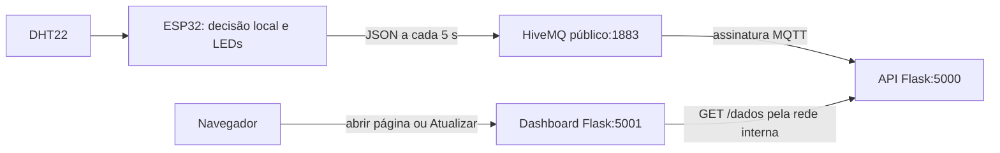

# CP06 · Smart Factory

Monitoramento de temperatura e umidade com **ESP32, DHT22, MQTT e duas aplicações Flask em Docker**. A decisão ocorre na borda: o ESP32 lê o sensor, define o estado e acende os LEDs. A API recebe a última leitura; o dashboard apresenta os dados.

> Projeto executado e demonstração integrada preparada em vídeo. O repositório já está público no GitHub. Falta publicar o vídeo no YouTube e inserir seu link real abaixo. Consulte [VALIDACAO.md](docs/VALIDACAO.md) para saber exatamente o que foi testado neste pacote.

## Identificação e links obrigatórios

| Campo | Preenchimento |
|---|---|
| Disciplina / curso | Edge Computing · Ciência da Computação · 2º ano |
| Integrantes (nome e RM) | Listados abaixo |
| Repositório público GitHub | [CP06 Smart Factory](https://github.com/RafaelQuattrer/cp06-smart-factory) |
| Projeto Wokwi | [CP06 Smart Factory](https://wokwi.com/projects/478070654175725569) |
| Vídeo YouTube (Não listado, 2 a 5 min) | PREENCHER COM O LINK REAL |

**Integrantes**

- Letícia Gabrielle Andrade Temóteo — RM 563985
- Bruno Otávio da Cruz Carvalho — RM 562354
- Rafael Quattrer Dalla Costa — RM 562052
- João Vitor Santana Silva Ribeiro — RM 564693

Os links do GitHub e do Wokwi foram verificados. Falta inserir o link do YouTube antes de entregar. O professor solicita o **link do repositório público**; o ZIP é um pacote para transportar os arquivos, não substitui os links obrigatórios.

## Vídeo preparado

O arquivo [CP06_Smart_Factory_Simples.mp4](video/CP06_Smart_Factory_Simples.mp4) tem **2 minutos**, sem narração, legendas ou apresentações. Mostra as telas reais dos contêineres, a espera inicial e a sequência **30 → 35 → 36 → 30 °C**, com LEDs, API e dashboard. Veja [VIDEO_GERADO.md](docs/VIDEO_GERADO.md) para os detalhes da captura.

Assista ao arquivo, publique no YouTube como **Não listado** e preencha o link real na tabela. O arquivo local não significa que o vídeo já foi publicado.

## Arquitetura



Fluxo das leituras: **ESP32 → HiveMQ → API → dashboard**. O navegador solicita a página ao dashboard; o backend do dashboard consulta `http://api:5000/dados`. O navegador não precisa resolver o nome interno `api`.

| Temperatura | Estado no ESP32 | LED verde | LED vermelho |
|---|---|---|---|
| ≤ 35 °C, incluindo exatamente 35 °C | NORMAL | Aceso | Apagado |
| > 35 °C | ALERTA | Apagado | Aceso |

A umidade é exibida, mas não interfere no estado. A API preserva o estado enviado pelo ESP32; não decide os LEDs e não envia comandos ao dispositivo.

## Comece por aqui

Pré-requisitos: Docker Desktop com Docker Compose v2, navegador e internet com acesso de saída a `broker.hivemq.com:1883`. Python 3.12 é necessário apenas para executar os testes fora dos contêineres. Não instale nem execute um broker local.

1. Extraia o ZIP e abra um terminal na pasta que contém este README e `compose.yaml`.
2. Execute:

   ```console
   docker compose up --build
   ```

3. Em outro terminal, confira os dois serviços:

   ```console
   docker compose ps
   docker compose logs -f api
   ```

4. Antes de iniciar o ESP32, abra [a API local](http://localhost:5000/dados). Ela deve responder **HTTP 503** com `{"mensagem":"Aguardando dados do ESP32"}`. O [dashboard local](http://localhost:5001) deve mostrar **Aguardando dados**, sem medições.
5. Monte/importe o Wokwi conforme a próxima seção e inicie a simulação. Aguarde conexão e a próxima publicação de 5 segundos. Clique em **Atualizar** no dashboard.

Para encerrar:

```console
docker compose down
```

O Compose inicia apenas `api` e `dashboard`, em contêineres distintos. As aplicações escutam em `0.0.0.0`, portas 5000 e 5001, com as mesmas portas publicadas no computador. O `/health` da API testa se o processo responde; `/dados` continua com 503 até a primeira leitura. Assim o dashboard pode abrir a tela de espera mesmo antes de ligar o ESP32.

## Simulação no Wokwi

1. Abra o [criador oficial de projeto ESP32](https://wokwi.com/projects/new/esp32). Este é um link da ferramenta, não o link do projeto entregue pela equipe.
2. Copie o conteúdo de `firmware/smart_factory/smart_factory.ino` para a aba **sketch.ino** do Wokwi.
3. Crie as abas **config.h** e **edge_logic.h**, copiando os arquivos de mesmo nome. Os cabeçalhos devem ficar ao lado do sketch.
4. Substitua o conteúdo de **diagram.json** pelo arquivo entregue. Ele inclui ESP32, DHT22, LEDs verde/vermelho, dois resistores de 220 Ω e um pull-up de 10 kΩ.
5. Crie **libraries.txt** com o conteúdo entregue ou instale pelo Library Manager **DHT sensor library for ESPx** e **PubSubClient**, nas versões indicadas.
6. Inicie a simulação. No monitor serial (115200 baud), acompanhe `[EDGE]`, conexão MQTT e `[MQTT ENVIADO]`.
7. Clique no DHT22 para alterar temperatura/umidade. Aguarde a próxima leitura/publicação; atualize API e dashboard.
8. Salve na sua conta e copie o link real do projeto para a tabela de identificação. Confirme o acesso em janela anônima.

| Componente | Ligação |
|---|---|
| DHT22 VCC / GND | 3V3 / GND |
| DHT22 SDA (dados) | GPIO 15; pull-up de 10 kΩ para 3V3 |
| LED verde | GPIO 18 → resistor 220 Ω → ânodo; cátodo → GND |
| LED vermelho | GPIO 19 → resistor 220 Ω → ânodo; cátodo → GND |
| DHT22 NC | Sem conexão |

No `diagram.json`, o modelo `wokwi-esp32-devkit-v1` identifica esses GPIOs como `D15`, `D18` e `D19`. No firmware, os números continuam 15, 18 e 19.

Rede simulada: `Wokwi-GUEST`, senha vazia, canal 6. A primeira leitura ocorre após cerca de 5 segundos de simulação. Ao perder internet, as leituras e os LEDs continuam locais. A publicação depende da rede e volta após reconexão; só a última leitura pendente é mantida, sem histórico. Em falha de sensor, não se publica medição inválida; os LEDs preservam o último estado (ambos começam apagados até a primeira leitura válida).

### Compilação local opcional

O projeto também inclui configuração PlatformIO. Na raiz:

```console
python -m pip install platformio==6.1.18
python -m platformio run --project-dir firmware
```

Para usar Wokwi no VS Code, compile antes e selecione `firmware/smart_factory/wokwi.toml` em **Wokwi: Select Config File**. O caminho do binário é relativo a esse arquivo. O fluxo principal da entrega é o Wokwi no navegador; a extensão pode exigir licença própria.

## MQTT: configuração compartilhada

Broker: **broker.hivemq.com**, porta **1883**, MQTT 3.1.1, sem autenticação. O firmware publica com QoS 0 e `retain=false`.

Tópico completo já configurado em todos os componentes:

```text
edge/2ano/turma-pendente/equipe-pendente/cp06-4f8ab7c291e64396/dados
```

O identificador foi escolhido para este pacote, sem dados pessoais e sem colchetes. Os segmentos `turma-pendente` e `equipe-pendente` são identificadores técnicos válidos do tópico já testado; não precisam ser preenchidos para executar. A personalização abaixo é opcional e exige sincronizar todos os componentes:

```console
python scripts/configurar_topico.py --turma 2cc --equipe nome-da-equipe
```

O script gera um novo identificador e sincroniza firmware, API, Compose, `.env.example` e este README (e `.env`, se existir). Rode antes de copiar o firmware para o Wokwi. Após alterar, recopie `config.h` para lá e recrie os contêineres. Use segmentos sem nomes pessoais ou RMs.

O ESP32 usa cliente `cp06-esp32-<chip>-<aleatório>`; a API usa `cp06-api-<aleatório>`. São distintos. O tópico exclusivo reduz a mistura acidental, **não oferece privacidade**: o broker é público. Publique somente leituras simuladas.

Exemplo do contrato (ilustrativo):

```json
{"temperatura":36.0,"umidade":60.0,"estado":"ALERTA"}
```

## API HTTP

| Requisição | Resposta |
|---|---|
| `GET /dados`, antes da primeira leitura | 503 e `{"mensagem":"Aguardando dados do ESP32"}` |
| `GET /dados`, após mensagem válida | 200 e os três campos do JSON recebido |
| `GET /health` | 200, estado do processo, conexão MQTT e horário UTC da última recepção |

A leitura fica somente em memória e é perdida ao reiniciar a API. A última leitura válida é preservada em desconexões, como solicitado; por isso o horário de consulta no dashboard não comprova uma nova medição. Para investigar sua idade, veja `ultima_leitura_em` em `/health` e os logs da API. Mensagens retidas, tópicos diferentes, JSON malformado, campos ausentes, strings no lugar de números, NaN, infinito e valores fora da faixa do DHT22 são ignorados. Uma mensagem inválida não substitui a última válida.

O dashboard aceita somente leituras válidas. Em 503, erro de rede, timeout ou resposta inválida, mostra **Aguardando dados** com orientação, sem inventar medidas. O botão Atualizar envia uma nova requisição ao backend. Não há atualização automática nem dependência de CDN, fontes ou scripts externos.

## Testes

Na raiz, em Windows/PowerShell:

```powershell
python -m venv .venv
.\.venv\Scripts\python.exe -m pip install -r requirements-dev.txt
.\.venv\Scripts\python.exe -m pytest -q
```

Em Linux/macOS, use `.venv/bin/python` no lugar de `.\.venv\Scripts\python.exe`.

Os testes cobrem contrato 503/200, validação MQTT, reconexão/assinatura, preservação do estado da borda, dashboard, erros de rede e consistência de tópico/Compose/circuito. O arquivo `tests/edge_logic_test.cpp` contém seis asserções estáticas sobre o mesmo cabeçalho de decisão compilado no ESP32; pode ser validado com `g++ -std=c++11 -c tests/edge_logic_test.cpp -o edge_logic_test.o`. Uma regressão no limite faz a compilação falhar.

Teste externo opcional com HiveMQ real (exige internet, publica dados sintéticos em um tópico de teste aleatório):

```console
python scripts/smoke_mqtt.py
```

Ele sobe API e dashboard locais em portas livres e percorre 30 → 35 → 36 → 30. Não usa o tópico da equipe, não executa broker e não substitui o teste do ESP32 ou Docker.

Com os contêineres ativos, `python scripts/verificar_docker.py --espera` confere o 503 inicial e a página sem medidas. Após definir uma temperatura no Wokwi e aguardar a publicação, use, por exemplo, `python scripts/verificar_docker.py --temperatura 35`. Essa verificação consulta as leituras reais, confirma os dois serviços saudáveis e a chamada interna `http://api:5000/dados`; não publica dados e não simula o ESP32.

Revisão visual opcional: instale `requirements-ui.txt`, execute `python -m playwright install chromium` e `python scripts/validar_interface.py`. Esse teste usa leituras sintéticas identificadas como fixtures, verifica o botão e salva capturas dos estados de espera, normal e alerta em telas largas e celulares. Essas capturas não são prova da simulação Wokwi.

### Teste manual obrigatório para o vídeo

Com os dois contêineres e o Wokwi em execução, mantenha umidade em 60% e percorra a sequência. Após **cada alteração**, aguarde a publicação MQTT seguinte, consulte `/dados` e clique em **Atualizar** no dashboard.

| Etapa | Temperatura | Estado | Verde | Vermelho |
|---|---|---|---|---|
| 1 | 30 °C | NORMAL | Aceso | Apagado |
| 2 | 35 °C | NORMAL | Aceso | Apagado |
| 3 | 36 °C | ALERTA | Apagado | Aceso |
| 4 | 30 °C | NORMAL | Aceso | Apagado |

Altere a umidade e confirme que o estado depende só da temperatura. Reinicie a API com a simulação parada e confirme novamente o 503 e a tela sem valores. O [roteiro do vídeo](docs/ROTEIRO_VIDEO.md) já organiza uma gravação de aproximadamente 3 a 4 minutos. O [passo a passo da gravação](docs/GRAVACAO_PASSO_A_PASSO.md) explica os cliques e comandos para quem vai gravar a tela.

## Dificuldade técnica tratada

Conectar o MQTT no mesmo fluxo de leitura pode atrasar o controle dos LEDs quando a rede demora a responder. A implementação usa uma tarefa de rede separada e uma fila de uma posição: o fluxo principal continua lendo o DHT22 e aplicando a regra local, enquanto a rede tenta reconectar. Essa escolha mantém o processamento na borda e evita acumular leituras antigas. O comportamento offline ainda deve ser conferido na simulação integrada, conforme o registro de validação.

Outro cuidado é diferenciar **processo disponível** de **dados disponíveis**. O healthcheck usa `/health` e não `/dados`, pois o 503 inicial é o comportamento correto. O dashboard trata essa espera normalmente.

## Estrutura

```text
.
├── README.md
├── compose.yaml
├── .env.example
├── api/                 # Flask, consumidor MQTT, Dockerfile e dependências
├── dashboard/           # Flask, template, CSS, ícone e Dockerfile
├── firmware/
│   ├── platformio.ini
│   └── smart_factory/   # sketch, cabeçalhos, diagrama, bibliotecas e Wokwi
├── tests/               # testes automatizados e regra C++
├── scripts/             # configuração e validações opcionais
└── docs/                # roteiro, checklist, requisitos e evidências
```

## Problemas comuns

| Sintoma | Ação |
|---|---|
| API responde 503 | Inicie Wokwi, aguarde 5 s e confira `[MQTT ENVIADO]`, tópico e logs da API |
| LEDs mudam, API continua esperando | Compare `config.h` com tópico da API; confira acesso ao HiveMQ:1883 e recrie contêineres após mudar configuração |
| Página mostra leitura anterior | Aguarde o próximo envio e clique Atualizar; confira `/health` e logs |
| Dashboard não encontra a API fora do Docker | Use o modo local abaixo; `api` é nome válido somente na rede do Compose |
| Porta já em uso | Libere 5000/5001; o enunciado pede os mapeamentos originais |
| `docker` não encontrado | Instale/abra Docker Desktop com Compose antes de executar |
| Compilador ESP32 falha com `CreateProcess` no Windows | Extraia/clone em um caminho curto, como `C:/projetos/cp06`, e tente novamente |
| 35 °C aparece como ALERTA | Confira o firmware e o tópico exclusivo; o código entregue usa `> 35`, não `>= 35` |

Execução local para desenvolvimento (dois terminais, dependências instaladas; não substitui a entrega Docker):

```powershell
# Terminal 1
python api/app.py
# Terminal 2, PowerShell
$env:API_URL = 'http://127.0.0.1:5000/dados'
python dashboard/app.py
```

## Antes de entregar

Use o [checklist de entrega](docs/CHECKLIST_ENTREGA.md). O projeto já está neste repositório **público**, com o README na raiz e o link real do Wokwi. Publique o vídeo como **Não listado** e insira o link real. Teste os três links em janela anônima, sem login e sem convite. Mantenha-os acessíveis até o fim da avaliação. Conforme o enunciado, links ausentes, quebrados ou privados invalidam a atividade.

## Referências

- Enunciado fornecido: *CP06 - Smart Factory*, 4 páginas (requisitos mapeados em [REQUISITOS.md](docs/REQUISITOS.md)).
- [Wokwi: Wi-Fi do ESP32](https://docs.wokwi.com/guides/esp32-wifi).
- [Wokwi: DHT22 e biblioteca recomendada para ESP32](https://docs.wokwi.com/parts/wokwi-dht22).
- [Paho MQTT Python: callbacks e loop de rede](https://eclipse.dev/paho/clients/python/docs/).
- [HiveMQ: broker público compartilhado](https://www.hivemq.com/mqtt/public-mqtt-broker/).
- [Docker Compose: ordem de início e healthchecks](https://docs.docker.com/compose/how-tos/startup-order/).

Projeto acadêmico de demonstração. Flask é executado sem debug/reloader; não há banco, login, histórico nem infraestrutura de produção, recursos não exigidos nesta CP.

Para gerar novamente o ZIP após suas alterações, execute `python scripts/empacotar.py`. O pacote é criado na pasta acima do projeto, com `MANIFEST.sha256` e checksum do ZIP. Não inclui `.env`, ambientes Python, cache de compilação nem arquivos temporários. Após personalizar o projeto, o registro de validação original continua se referindo à versão preparada nesta data; registre seus próprios testes finais.
